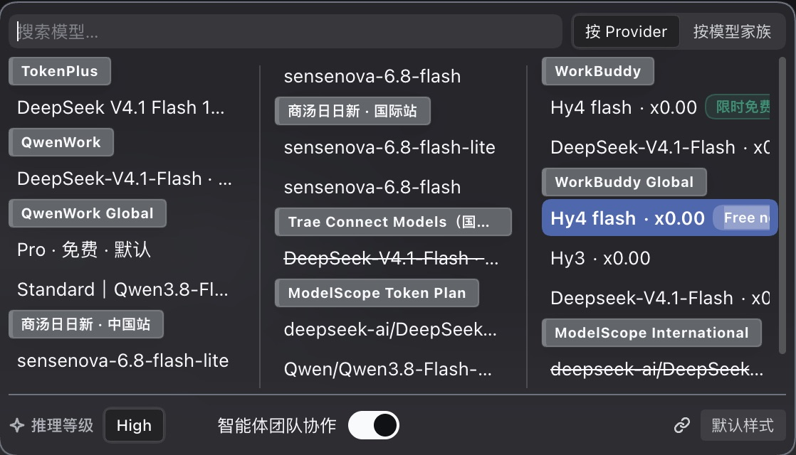

# dsh-model-flatmap

> A flat, two-level-free model picker for the DeepSeek Harness (DSH) composer:
> every model and reasoning level on one surface, no second-level menus.

[简体中文](./README.zh.md)

## What it is

`dsh-model-flatmap` is a **client-side** DSH plugin that runs in both the **Web GUI and the
Desktop app**. It replaces the composer's `conversation.input.model` seat with a single flat
panel rendered in the client UI.
Instead of nested popovers, the whole catalogue is one searchable grid where the
model grid, the current model's reasoning levels, and the agent-teamwork switch
are all visible at once.

The plugin reads and writes through **public Client APIs only** — the per-Session
model directory, the teamwork setting, and the host's locale. The host half
(`index.js`) contributes no service, tool, or event; the UI lives in `client.js`,
which registers with a negative priority so it shadows the shipped `ModelSelect`
while active. Disabling the plugin restores the native control with no residue.

The host half has one job of its own: an **anonymous daily heartbeat**
(`telemetry.js`). It sends at most one request per machine per local day to
`https://dsh.zuos.us/api/e` — installation id, plugin id, plugin version,
platform, architecture, event kind and the protocol version — and nothing else:
no prompt, no session content, no model name, no path, no username, no IP. A
process that stays open across midnight re-checks every six hours, so a window
left running all night still counts for the new day rather than only for the day
it was launched.

The installation id is a random UUIDv4 created on first run and unrelated to any
account; deleting `~/.dsh/dsh-model-flatmap/analytics.json` gives the machine a
new one. The heartbeat is `void`-ed and every failure is swallowed, so the picker
never waits for it and never fails because of it. It exists because npm download
counts cannot answer "how many machines actually run this, and how many ran it
today" (installs, CI and mirrors all count), and a Client-side counter cannot
either (a tab nobody reloads reports nothing). There is no toggle: the bundle
ships no settings page, so a switch nobody can reach would only dress a default
up as a user choice; disabling the bundle stops the heartbeat with the UI.

## Screenshot

The panel in action — a flat grid of models, the current model's reasoning
levels, and the agent-teamwork switch on one surface:



## Features

- **One surface.** The trigger opens one panel capped at 320 px. The header, the
  reasoning row, and the teamwork row stay fixed; only the model grid scrolls.
- **The trigger shows what the native one shows.** Its name is not a string: the
  shipped picker renders the `conversation.input.model.label` slot there, and
  connection plugins use it for a promotion chip (`夜间折扣`), a rate, or a load
  mark (queued people / a rocket when idle). This plugin renders that slot's
  winning component on its own trigger — with the seats it needs — so the two
  modes show the same content. A missing or crashing occupant falls back to the
  catalog name plus the model's own `model.badge`.
- **Global search.** Filters across every provider and every family. Groups that
  end up empty are dropped, so no stray headings remain. Prefix matches rank
  first, then substring matches, then ordered character matches.
- **Word-wise search.** Whitespace splits the query into tokens, and every token
  must land somewhere in the name. A hit ranks by its weakest token.
- **Provider-wide search.** A query that matches a *provider* (its id, catalog
  name, or section label) keeps that provider's entire catalogue in the grid.
- **Two grouping modes.** A segment control switches the grid between
  *By provider* and *By family*. Grouping and search are independent.
- **Model families.** A built-in dictionary recognises DeepSeek, Grok, Opus,
  Haiku, Sonnet, Claude, Qwen, GLM, Kimi, GPT, Gemini, Llama, Mistral and others.
  Unrecognised models are inferred from their id; anything unjudgeable falls into
  *Others* (always sorts last). Families stay flat — no nesting.
- **Generations are kept apart.** A registered brand splits by generation:
  `hy3` → `HY3`, `hy4free` / `hy4std` / `hy4-preview` → `HY4`, and a bare `hy`
  → `HY`. Unregistered brands still collapse their version tail; dictionary
  families (GPT, Qwen…) are never split.
- **Rows are provider-primary, with a model tail.** Under *By family* the
  heading already says what the models are, so the family name is not repeated
  in a row: the primary text is the provider name. What neither the heading nor
  the provider can say — which model of the family the row is, and the
  catalog's rate multiplier — is drawn as a quieter tail at the end of the row,
  with the family name and the provider label stripped off: `Qwen3.8-27B` under
  *Qwen* reads `3.8-27B`, and `Deepseek-V4.1-Flash · x0.01` under *DeepSeek*
  reads `V4.1-Flash · x0.01` with the multiplier drawn smaller and bold. The
  full model name and description stay in the tooltip.
- **Long names and long headings scroll on hover.** A clipped model name or
  group heading runs one eased leftward pass after the pointer rests on it for
  0.5 s, then stops; leaving resets it instantly. Only the text moves — the
  trailing badge and the title's band never do.
- **Reasoning effort.** The current model's reasoning levels render as an
  exclusive, keyboard-operable group ("推理等级" / "Reasoning effort") driven by
  radio semantics.
- **Adaptive footer.** The reasoning group and the agent-teamwork switch share
  one line when both fit with a 30 px gap, and fall back to one row each when
  they do not — the break is CSS flex wrapping, not a measured pixel threshold.
- **Out-of-balance models are struck through — everywhere, for a day.** A model
  whose last call failed on insufficient balance, credit, or quota keeps a
  `line-through` on its row text until a later call for that same model returns
  anything else, and until the mark has gone 24 hours without a new attempt —
  whichever comes first. A balance is topped up and a quota resets daily, so a
  strike nobody refreshed is stale information, not a warning. The strike
  follows the model the failing request actually used, and covers the
  Host's `QUOTA` / `ACCOUNT_QUOTA` codes, a provider `402`, and a `429` whose
  body reports an empty balance — a plain rate limit never strikes. Because a
  balance is a property of the model route and its account, **not of one
  conversation**, the marks are global: a failure seen in any Session strikes
  the model in every Session and workspace, and the state is persisted to
  `localStorage` so it survives a reload. Every mark keeps the time of the
  observation that made it, so opening the list a day later draws that row
  plain. Observations are ordered by that same time, so the newest one wins and
  replaying older history cannot resurrect a strike that has already ended —
  by a later call or by age.
- **Theme-aware.** Styled with host theme tokens only; looks correct in both
  light and dark themes.
- **Project link.** Immediately left of the `Default style` button sits a link
  icon that opens this project's GitHub page in a new tab. The address is **not
  hardcoded**: the Host reads the checkout's configured remotes with
  `git remote -v` (`origin` first, then `upstream`, then the rest) and turns
  every spelling git writes — `git@github.com:owner/repo.git`,
  `https://github.com/owner/repo.git`, `ssh://`, `git://`,
  `github.com:owner/repo` — into the same `https://github.com/owner/repo` page.
  A remote on another host (GitLab, Bitbucket, a self-hosted server) is skipped
  rather than rewritten to github.com: rewriting would open a *different*
  repository with nothing on screen saying so. Renaming the repository, moving
  it to another owner, or adding a fork upstream all change the destination
  without touching this plugin. When the checkout has no usable GitHub remote
  (an npm-installed copy ships no `.git`), the button opens this project's home
  page and its tooltip says that is the fallback. The URL is prefetched when the
  panel opens, so an ordinary click is a synchronous `window.open` that a popup
  blocker will not eat; the tab opens with `noopener,noreferrer`, and only
  `http(s)` addresses can reach it. Clicking it does not affect the
  `Default style` button, whose look, `aria-pressed` meaning and disabled rule
  are unchanged.
- **Native mode.** The panel's bottom-right `Default style` button hands the
  composer's model seat back to the **host's own** picker — the real shipped
  `ModelSelect`, not a reproduction of it. The plugin does this by *stepping
  aside*: it disposes its own `conversation.input.model` registration, so the
  host's entry underneath wins the slot and renders itself. Nothing is
  imported, copied, or re-mounted, which means an upgraded DSH shows its own
  newest picker and this mode can never drift out of date. The way back is a
  separated action band at the bottom of that picker's own menu — it reuses the
  `conversation.input.model.options` child slot the shipped `ModelSelect`
  declares, so it belongs to the panel it acts on and renders nothing at all
  while the flat panel is shown. It is drawn as an outlined button, not as one
  more menu row: the rows above it pick a value, this one performs an action.
  The choice is remembered across reloads. If the host ships no picker to hand
  over to, the button stays disabled and the panel stays — the composer never
  ends up without a model control.

See [`docs/DETAIL.md`](./docs/DETAIL.md) for the full behaviour spec and
[`DECISIONS.md`](./DECISIONS.md) for the decision log behind the design.

## Installation

This package is a DSH **bundle**. Install it from your DSH profile (the plugin
manager), or drop it into the profile's bundle directory so the `dsh` loader
picks up `cordis.patch.yml`.

```bash
# Example: install the bundle into a running profile (paths vary by install)
cp -r . "<profile>/bundles/dsh-model-flatmap"
```

Enable or disable the plugin from the profile's plugin list — no native control
is touched when the bundle is off.

## Project layout

| Path                 | Purpose                                                  |
| -------------------- | -------------------------------------------------------- |
| `index.js`           | Host half — bundle entry; starts the anonymous daily heartbeat. |
| `telemetry.js`       | The heartbeat itself: pure day/decision functions, plus an injectable reporter. |
| `client.js`          | Browser half — the entire flat picker UI.                |
| `cordis.patch.yml`   | Cordis patch applied by the `dsh` bundle loader.         |
| `locale/en.json`     | English copy and metadata.                               |
| `locale/zh.json`     | Simplified-Chinese copy and metadata.                    |
| `docs/DETAIL.md`     | Detailed behaviour specification.                        |
| `test/`              | Render-path tests driven through a minimal hook runtime. |

## Development

The plugin is plain ES modules with no build step.

```bash
# Run the render-path tests (no browser required)
node --test test/
```

Tests read `client.js` directly and drive the real component through a minimal
hook runtime to catch crashes, missing sections, and wrong column counts.
`test/telemetry.test.mjs` covers the heartbeat instead: the day boundary, the
once-a-day gate, the payload's field whitelist, degradation after repeated
failures, and the promise that a dead endpoint costs nothing. No test touches
the network — `fetchImpl` and the clock are injected.

## License

Released under the [MIT License](./LICENSE).
