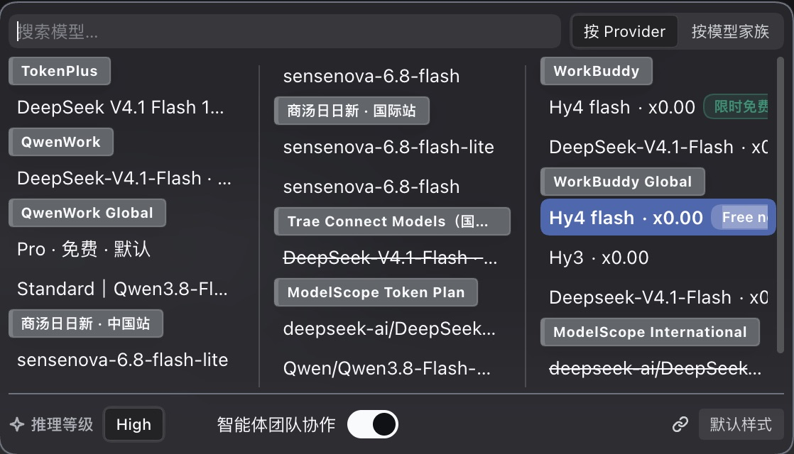

# dsh-model-flatmap

> 一个平铺、无二级菜单的 DeepSeek Harness（DSH）模型选择器：所有模型与推理等级
> 都在同一平面上，没有层层弹层。

[English](./README.md)

## 这是什么

`dsh-model-flatmap` 是一个**客户端** DSH 插件，在 **Web GUI 与桌面端** 均生效。它把会话输入框中的
`conversation.input.model` 控件替换成一个平铺面板，渲染在客户端界面中。面板没有
嵌套的二级菜单：模型网格、当前模型的推理等级，以及智能体协作开关，全部同时可见。

插件**只通过公开的 Client API 读写数据**——每个会话的模型目录、协作设置、以及宿主
的语言文案。宿主部分（`index.js`）不提供任何服务、工具或事件；UI 全部在
`client.js` 中，注册时使用负优先级以在启用期间覆盖原生的 `ModelSelect`。关闭插件
即可无残留地恢复原生控件。

宿主部分只做一件事：**匿名每日心跳**（`telemetry.js`）。每台机器每个当地日至多发一次，
地址是 `https://dsh.zuos.us/api/e`，内容是安装 id、插件标识、插件版本、平台、架构、
事件类型与协议版本，**别的一概不发**：没有 prompt、没有会话内容、没有模型名、
没有路径、没有用户名、没有 IP。跨过午夜仍然开着的进程每 6 小时复查一次，所以整夜没关的
窗口也会计入新的一天，而不只是启动它的那一天。安装 id 是首次运行生成的随机 UUIDv4，与任何账号无关；
删掉 `~/.dsh/plugins/dsh-model-flatmap/analytics.json` 即换一个新身份。
旧地址 `~/.dsh/dsh-model-flatmap/` 会在首次启动时被整体搬过去（只搬一次）；
若 `~/.dsh/plugins/dsh-model-flatmap/` 已存在则绝不覆盖、绝不合并。心跳被 `void` 掉，所有失败
都被吞成一条日志，所以面板既不等它、也不会因为它出故障。之所以有这个心跳：npm 下载数
回答不了「到底有多少台机器在跑、今天有多少台还在用」（装机脚本、CI、镜像都会计入），
而纯客户端计数同样回答不了（没人重载的标签页什么都不报）。

**智能体团队协作的默认值。** 「设置 → 模型列表」底部有一个*启用智能体团队协作*开关，
它控制**新会话**是否默认开启团队协作。这个偏好存在插件的配置文件
`~/.dsh/dsh-model-flatmap/config.yaml` 里的 `teamDefault: true|false`，
和显示开关、Provider 重命名放在同一个文件里——可以直接编辑，保存后生效。
新建会话（且该会话从未保存过团队协作选择）时，宿主会在它的第一个模型步之前按这个
默认值写入该会话的 `team/mode`，所以第一轮请求就带着团队工具；已经保存过的选择永远
优先，显式关掉的不会被改回开启。
（早期版本把它只存在浏览器 `localStorage` 里，既没有任何地方去读，桌面版每次启动又是
不同的 `127.0.0.1:<随机端口>`，而 `localStorage` 按 origin 隔离——所以你设完重启就没了。
改为文件后这两个问题一起消失；旧的 `{"enabled":true}` 会在首次启动时自动搬过来。）

**可以关掉。** 「设置 → 模型列表」面板底部有一个*匿名使用统计*开关，**默认开启**。
这是选择性退出（opt-out）：从没打开过设置页的机器照旧上报，所以这个开关是真正的选择，
而不是把默认值装扮成用户的选择。开关住在浏览器（`localStorage`）里，但心跳由宿主发送，
所以拨动它会通过一条带信任栅栏的路由把选择同步到宿主，宿主在每次发送前重读该选择：
下一次心跳（当天晚些时候，或下次启动）就会遵守它，无需重启。参见 DEC-035。
整体停用 bundle 时心跳仍然随 UI 一起停止。

## 截图

运行中的面板——模型平铺网格、当前模型的推理等级，以及智能体协作开关，
全部位于同一平面上：

## 许可证

基于 [MIT 许可证](./LICENSE) 发布。
